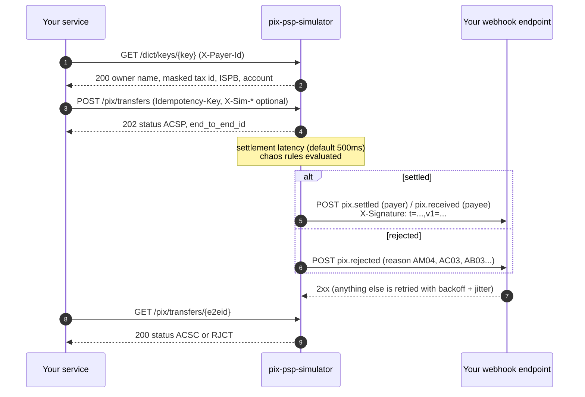

# pix-psp-simulator

[](https://github.com/victorcondackdev/pix-psp-simulator/actions/workflows/ci.yml)
[](https://pkg.go.dev/github.com/victorcondackdev/pix-psp-simulator)
[](LICENSE)

A local sandbox that plays the parts of a Pix PSP, the SPI and the DICT, so a
team can build and test a Pix integration offline: instant transfers, key
lookups, QR charges, signed webhooks, devoluções, MED, and the failures that
production will eventually throw at you, on demand.

One static binary, no database, no external services. Start it, seed it with a
scenario file, point your service at it, and make it misbehave.

## Why

Integrating with Pix means integrating with asynchronous, failure-prone
infrastructure. The interesting bugs are not in the happy path:

- a transfer is accepted and then rejected seconds later with `AM04`;
- the SPI times out (`AB03`) after your request already returned;
- the same webhook arrives twice, or `pix.settled` arrives before your own
  database committed the payment;
- a dynamic QR code expires while the customer is still on the payment screen;
- a MED infraction blocks funds you already considered yours.

Provider sandboxes rarely let you trigger these deterministically, are often
rate limited or down, and cannot be run in CI. This simulator makes every one
of those cases a header or a line in a JSON file.

It is built on [brpay](https://github.com/victorcondackdev/brpay) for the
parts that must be exactly right: Pix key normalization (including the
alphanumeric CNPJ), BR Code generation, decoding and linting, EndToEndId
generation and document masking.

## Features

| Area | What you get |
|------|--------------|
| DICT | Register, delete and look up CPF, CNPJ (numeric and alphanumeric), e-mail, phone and EVP keys; masked owner document (`***.982.247-**`); 5/20 keys per account; ownership and portability claims with a resolution period; per-payer token-bucket rate limiting with a heavier cost for missing keys |
| Charges (`/cob`) | Static and dynamic BR Codes; dynamic payload served at `/qr/v2/{id}`; expiration; single-use dynamic charges |
| Payments | By key, by account details (manual), by account ID, or by "copia e cola" (decoded and linted; lint errors come back as structured issues) |
| Settlement | Asynchronous, configurable latency, `ACSP` then `ACSC` or `RJCT` with ISO 20022 reason codes, on a double-entry in-memory ledger (int64 cents) |
| Devoluções | Full or partial, multiple per transfer, up to the original amount (`BE08`, `MD06`, `SL02`) |
| MED | Infraction report, cautionary block, analysis, refund (`FR01`) or release, as an explicit state machine |
| Webhooks | `pix.received`, `pix.settled`, `pix.rejected`, `refund.completed`; HMAC-SHA256 signatures; retries with exponential backoff and jitter; delivery log; redelivery |
| Chaos | Per-request headers and global rules: forced rejection codes, probabilistic timeouts, latency, duplicate and out-of-order webhooks |
| Time travel | `POST /admin/clock/advance` moves the simulator clock; due settlements and retries run immediately, charges and claims expire |
| Operations | Embedded dashboard at `/`, OpenAPI 3.1 at `/openapi.json`, `/healthz`, JSON logs with request IDs, problem+json errors, `Idempotency-Key` |

## How it fits



## Quickstart

Run it from source (Go 1.22+):

```sh
go run ./cmd/pixsim -scenarios scenarios/basic.json -log-format text
```

or with Docker Compose, which also starts an example consumer that verifies
signatures and drops duplicates:

```sh
docker compose up --build
open http://localhost:8080          # dashboard
```

The examples below assume the simulator on `localhost:8080` and the example
receiver on `localhost:9000` with secret `whsec_demo`
(`go run ./examples/webhook-receiver -secret whsec_demo` if you are not using
Compose; inside Compose use `http://receiver:9000/pix` as the webhook URL).

**1. Create accounts** (or rely on `scenarios/basic.json`, which already has
`alice`, `bob`, `padaria` and a closed account):

```sh
curl -s localhost:8080/accounts -H 'Content-Type: application/json' -d '{
  "id": "carol", "owner_name": "Carol Lima", "document": "111.444.777-35",
  "initial_balance_cents": 20000
}'
```

**2. Register a key** and look it up the way a payer's app would:

```sh
curl -s localhost:8080/dict/keys -H 'Content-Type: application/json' \
  -d '{"account_id": "carol", "key": "Carol@Example.com"}'

curl -s localhost:8080/dict/keys/carol@example.com -H 'X-Payer-Id: alice'
# { "key": "carol@example.com", "key_type": "EMAIL", "owner_name": "Carol Lima",
#   "owner_tax_id_masked": "***.444.777-**", "owner_type": "NATURAL_PERSON", ... }
```

**3. Register a webhook** for the payee:

```sh
curl -s -X PUT localhost:8080/accounts/carol/webhook -H 'Content-Type: application/json' \
  -d '{"url": "http://localhost:9000/pix", "secret": "whsec_demo"}'
```

**4. Transfer** and watch it settle:

```sh
curl -s localhost:8080/pix/transfers -H 'Content-Type: application/json' \
  -H 'Idempotency-Key: order-1001' \
  -d '{"from_account_id": "alice", "key": "carol@example.com", "amount_cents": 2500}'
# 202 { "end_to_end_id": "E99999999202611211559...", "status": "ACSP", ... }

curl -s localhost:8080/pix/transfers/E99999999202611211559...   # "status": "ACSC"
```

**5. Receive the webhook.** The receiver logs a verified `pix.received`
event. The delivery log shows every attempt:

```sh
curl -s 'localhost:8080/webhooks/deliveries?account_id=carol'
```

**6. Inject failures:**

```sh
# Rejected for insufficient funds; pix.rejected goes to the payer's webhook
# (if alice has one registered) twice, with the same event ID
curl -s localhost:8080/pix/transfers -H 'Content-Type: application/json' \
  -H 'X-Sim-Fail: AM04' -H 'X-Sim-Webhook-Duplicates: 1' \
  -d '{"from_account_id": "alice", "key": "carol@example.com", "amount_cents": 100}'

# SPI timeout after 5 seconds, 30% of the time
curl -s localhost:8080/pix/transfers -H 'Content-Type: application/json' \
  -H 'X-Sim-Fail: AB03' -H 'X-Sim-Fail-Probability: 0.3' -H 'X-Sim-Latency: 5s' \
  -d '{"from_account_id": "alice", "key": "carol@example.com", "amount_cents": 100}'
```

**7. Charges and time travel:**

```sh
curl -s localhost:8080/cob -H 'Content-Type: application/json' -d '{
  "type": "dynamic", "receiver_account_id": "padaria",
  "amount_cents": 1590, "expires_in_seconds": 600
}'
# -> "brcode": "000201010212266700...", "location": "http://localhost:8080/qr/v2/..."

curl -s localhost:8080/pix/qr-payments -H 'Content-Type: application/json' \
  -d '{"from_account_id": "alice", "brcode": "<brcode from above>"}'

# Create another charge, leave it unpaid, and jump past its expiration:
curl -s localhost:8080/admin/clock/advance -H 'Content-Type: application/json' \
  -d '{"duration": "15m"}'
curl -s localhost:8080/cob/<txid>   # "status": "REMOVIDA_PELO_PSP", "expired": true
```

Malformed codes are rejected with brpay's lint report:

```json
{
  "type": "urn:pixsim:problem:brcode_lint_failed",
  "status": 422,
  "code": "brcode_lint_failed",
  "issues": [
    { "severity": "error", "field": "63", "message": "CRC is \"ABCD\", expected 5F03 (...)" },
    { "severity": "error", "field": "54", "message": "amount \"100,00\": uses a comma; the decimal separator must be a dot" }
  ]
}
```

**8. Refund and MED:**

```sh
E2E=E99999999202611211559...
curl -s localhost:8080/pix/transfers/$E2E/refunds -H 'Content-Type: application/json' \
  -d '{"amount_cents": 500, "reason": "MD06"}'

curl -s localhost:8080/med/infractions -H 'Content-Type: application/json' \
  -d "{\"end_to_end_id\": \"$E2E\", \"details\": \"social engineering\"}"
curl -s -X POST localhost:8080/med/infractions/inf_.../block
curl -s -X POST localhost:8080/med/infractions/inf_.../analyze
curl -s -X POST localhost:8080/med/infractions/inf_.../accept   # held funds go back to the payer (FR01)
```

The full API, including request and response schemas and the webhook payload,
is in [`/openapi.json`](internal/api/openapi.json).

## Verifying webhooks

Every delivery carries:

| Header | Meaning |
|--------|---------|
| `X-Signature` | `t=<unix seconds>,v1=<hex HMAC-SHA256(secret, "<t>.<raw body>")>` |
| `X-Event-Id` | Stable across retries and chaos duplicates: deduplicate on it |
| `X-Event-Type` | `pix.received`, `pix.settled`, `pix.rejected`, `refund.completed` |
| `X-Delivery-Id`, `X-Delivery-Attempt` | Which copy and which try this is |

Import the helper instead of re-implementing it:

```go
import "github.com/victorcondackdev/pix-psp-simulator/webhook"

body, _ := io.ReadAll(r.Body)
if err := webhook.Verify(secret, r.Header.Get(webhook.SignatureHeader), body, 5*time.Minute); err != nil {
    http.Error(w, "invalid signature", http.StatusUnauthorized)
    return
}
var ev webhook.Event
_ = json.Unmarshal(body, &ev)
```

`Verify` accepts several `v1` values (secret rotation), compares in constant
time and rejects timestamps outside the tolerance. Signatures use wall-clock
time even after the simulator clock has been advanced, so consumers verifying
with their own clock keep working. Failed deliveries (non-2xx, timeouts,
connection errors) are attempted up to 6 times, waiting `1s, 2s, 4s, ...`
(capped at 5 minutes, each with equal jitter) between attempts.

## Chaos headers

Accepted by `POST /pix/transfers`, `POST /pix/qr-payments` and
`POST /pix/transfers/{e2eid}/refunds`. Headers override global rules.

| Header | Example | Effect |
|--------|---------|--------|
| `X-Sim-Fail` | `AM04` | Reject with this reason code after the settlement latency |
| `X-Sim-Fail-Probability` | `0.25` | Apply `X-Sim-Fail` only with this probability |
| `X-Sim-Timeout` | `true` | Reject with `AB03` (settlement timeout) |
| `X-Sim-Latency` | `2s` | Override the settlement latency for this request |
| `X-Sim-Webhook-Duplicates` | `2` | Send each resulting webhook N extra times, same event ID |
| `X-Sim-Webhook-Reorder` | `3s` | Delay each delivery by a random amount up to this, so events can arrive out of order |

Supported reason codes, plus those the simulator produces on its own:

| Code | Meaning | Produced automatically when |
|------|---------|-----------------------------|
| `AC03` | Invalid creditor account number | Manual transfer to account details that do not exist |
| `AC04` | Closed account number | Payee account is `CLOSED` |
| `AC06` | Blocked account | Payee account is `BLOCKED` |
| `AM02` | Amount not allowed | Amount above `-max-transfer-cents` |
| `AM04` | Insufficient funds | Payer balance too low (transfers and refunds) |
| `AB03` | Settlement aborted due to timeout | Chaos only |
| `BE01` | Inconsistent with end customer | Chaos only |
| `DS04` | Order rejected | Chaos only |
| `RR04` | Regulatory reason | Chaos only |

## Scenario files

Scenarios seed accounts, keys, webhooks, chaos rules and the DICT rate limit.
Load them at startup (`-scenarios 'scenarios/*.json'`, applied in file-name
order) or at runtime with `POST /admin/scenarios`. Unknown fields are
rejected, so typos fail loudly.

```json
{
  "name": "checkout",
  "description": "Merchant with noisy webhooks and a flaky SPI",
  "accounts": [
    { "id": "alice", "owner_name": "Alice Santos", "document": "529.982.247-25",
      "initial_balance_cents": 500000 },
    { "id": "shop", "owner_name": "Loja Exemplo Ltda", "document": "12.ABC.345/01DE-35",
      "ispb": "12345678", "branch": "0042", "number": "778899", "type": "CACC",
      "webhook": { "url": "http://localhost:9000/pix", "secret": "whsec_demo" } },
    { "id": "gone", "owner_name": "Old Account", "document": "111.444.777-35", "status": "CLOSED" }
  ],
  "keys": [
    { "account_id": "shop", "key": "12ABC34501DE35" },
    { "account_id": "shop", "evp": true }
  ],
  "chaos_rules": [
    { "id": "flaky-spi", "probability": 0.05, "match": { "operation": "qr_payment" },
      "timeout": true, "latency": "3s" },
    { "id": "big-tickets", "match": { "operation": "transfer", "min_amount_cents": 1000000 },
      "fail": "AM02" },
    { "id": "noisy-webhooks", "match": { "to_account": "shop" },
      "duplicate_webhooks": 1, "reorder_webhooks": "2s" }
  ],
  "dict_rate_limit": { "capacity": 100, "refill_per_minute": 20, "not_found_cost": 3 }
}
```

Rule fields: `match` (`operation`: `transfer`, `qr_payment` or `refund`;
`from_account`; `to_account`; `min_amount_cents`; `max_amount_cents`; all
optional), `probability` (0 to 1, default 1), and any of `fail`, `timeout`,
`latency`, `duplicate_webhooks`, `reorder_webhooks`. Durations are Go
duration strings or milliseconds. Rules are evaluated in order and later
matches override earlier ones; manage them at runtime under
`/admin/chaos/rules`.

## Configuration

Every flag has a `PIXSIM_*` environment variable (`-settlement-latency` is
`PIXSIM_SETTLEMENT_LATENCY`); flags win.

| Flag | Default | |
|------|---------|---|
| `-addr` | `:8080` | Listen address |
| `-ispb` | `99999999` | Simulator ISPB, used in EndToEndIds and new accounts |
| `-base-url` | `http://localhost:<port>` | Public URL put in dynamic QR codes |
| `-settlement-latency` | `500ms` | Time from `ACSP` to `ACSC`/`RJCT` |
| `-charge-expiry` | `1h` | Default expiration of dynamic charges |
| `-max-transfer-cents` | `0` | Larger transfers are rejected with `AM02` (0 disables) |
| `-scenarios` | | Comma-separated files or globs |
| `-seed` | `0` | Seed for chaos probabilities and jitter; set it for reproducible runs |
| `-webhook-max-attempts` | `6` | Attempts per delivery |
| `-webhook-base-backoff` | `1s` | First retry delay; doubles each attempt, capped at 5m |
| `-webhook-timeout` | `5s` | Per-attempt timeout |
| `-log-level`, `-log-format` | `info`, `json` | slog level and `json`/`text` |
| `-healthcheck` | | Probe `/healthz` and exit; used by the image's `HEALTHCHECK` |

## Design notes

- **Money is conserved by construction.** Every movement is a single posting
  between two accounts. Funds of in-flight transfers sit in a settlement
  account, MED blocks in a hold account, and seeded balances come from a
  funding account that is the only one allowed to go negative, so the sum of
  all balances is always zero. Tests hammer the ledger with concurrent
  transfers under `-race` and assert no negative balance and exact
  conservation.
- **State machines are data.** DICT claims and MED infractions are declared as
  transition tables (`internal/fsm`); invalid transitions return `409` with
  the allowed events.
- **Time is injected.** Everything reads a `clock.Clock`. Tests use a fake
  clock that runs timers synchronously, so retry schedules and expirations
  are asserted to the millisecond without sleeping. The server uses a virtual
  clock that can only move forward.
- **Failures are first-class.** Business rejections never fail the HTTP call:
  the transfer is accepted and ends `RJCT` with a reason and a webhook, the
  way the SPI behaves.

Layout:

```
cmd/pixsim            binary: flags, env, graceful shutdown
webhook/              public: Sign, Verify, Event (import this in consumers)
internal/api          HTTP handlers, problem+json, middleware, OpenAPI, dashboard
internal/sim          accounts, transfers, charges, refunds, MED, scenarios
internal/dict         DICT keys, claims, rate limiting
internal/ledger       double-entry ledger
internal/notify       webhook delivery with retries
internal/chaos        rules and header overrides
internal/clock        real, fake and virtual clocks
internal/fsm          transition tables
internal/iso          ISO 20022 status and reason codes
examples/             webhook receiver that verifies and deduplicates
scenarios/            example scenario files
```

## Development

```sh
make workspace   # go.work pointing at ../brpay, for local development
make lint        # gofmt check + go vet
make cover       # go test -race with coverage, fails under 80%
make run         # all scenarios, text logs
make docker
```

## Disclaimer

This project is not affiliated with, endorsed by or connected to the Banco
Central do Brasil or any PSP. It implements simplified models of Pix, the
SPI, the DICT, devoluções and MED for development and testing; message
formats, state machines, limits, rate-limit policies and reason-code usage
are approximations chosen to be useful in tests, not a reference
implementation of the regulations or of any participant's behaviour. The
dynamic QR payload is served as plain JSON rather than a signed JWS, and there
is no mTLS, no ISO 20022 XML and no persistence. Do not use it in production
or with real customer data.

## License

[MIT](LICENSE) © 2026 Victor Condack
